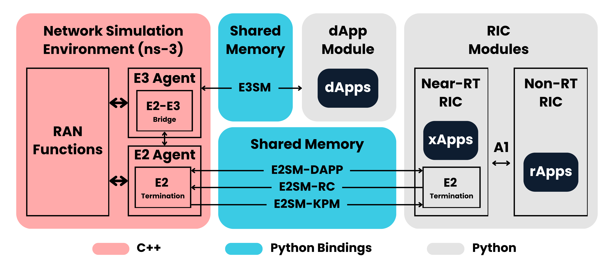

# ib-ORAN: Intent-Based Open RAN

An ns-3-based Open RAN simulation environment with native support for intent-based orchestration.

[](https://spdx.org/licenses/MIT.html)
[](https://www.nsnam.org)
[](https://www.3gpp.org/)
<!-- [](https://sites.google.com/view/anrcomsema) -->

## License

The original contributions in this repository are licensed under the [MIT License](https://spdx.org/licenses/MIT.html).

> This means you are free to use, modify, and distribute this software, with or without modification, provided you retain the original copyright notice. See the [`LICENSE`](/LICENSE) file for the full terms.

## Third-Party Components

This project makes use of third-party open-source components. Their copyright
notices and license terms are preserved in their respective directories and
summarized in [`THIRD-PARTY.txt`](THIRD-PARTY.txt). Do not remove or modify
the license and copyright files present in any third-party component directory.

## Table of Contents

1. [Overview](#overview)
2. [Architecture](#architecture)
3. [Getting Started](#getting-started)
4. [Visualization via NetAnim](#visualization-via-netanim)
5. [Troubleshooting](#troubleshooting)
6. [Acknowledgements](#acknowledgements)
7. [Further Reading](#further-reading)


## Overview

ib-ORAN (module name: `ns3-iboran`) is a comprehensive simulation environment and design framework built on the proven [ns-3](https://www.nsnam.org) network simulator. It is primarily developed to implement and verify intent-based operations within Open RAN architectures.

This framework enables direct control of Physical Layer (PHY) and Medium Access Control (MAC) functions through RAN applications — rApps and xApps hosted on RAN Intelligent Controllers (RICs), as well as distributed dApps — spanning the full spectrum of control timescales from non-real-time (non-RT) to near-real-time (near-RT) to real-time.

ib-ORAN bridges high-performance ns-3 C++ simulations and Python-based policy logic via a shared-memory interface, decoupling the simulation engine from the control plane without sacrificing performance. This architecture natively supports non-RT and near-RT RIC implementations alongside real-time dApp design, enabling intent-based, semantics-aware exchange of payload data across diverse use cases.

Building on the foundations of [ns3-gym](https://github.com/tkn-tub/ns3-gym) and [ns3-ai](https://github.com/hust-diangroup/ns3-ai), ib-ORAN extends both frameworks with intent-based and semantics-aware capabilities purpose-built for Open RAN network control — going beyond reinforcement learning hooks to provide a full orchestration layer for intelligent, policy-driven RAN behavior.

ib-ORAN supports both 3GPP LTE and New Radio (NR) standards:
- **LTE**: implemented through an adapted version of the built-in `lte` module in ns-3.
- **NR**: built on top of the [ns-3 nr](https://gitlab.com/cttc-lena/nr) module.


## Architecture

<div align="center">
  
</div>

The architecture spans three control planes — non-RT RIC, near-RT RIC, and real-time dApp layer — interconnected through standardized E2 and A1 interfaces and the newly introduced E3 interface. The shared-memory bridge between ns-3 and the Python orchestration layer is a core design principle, enabling clean separation of simulation logic from intelligent control.

### Message Exchange Structures

See the [detailed message structure reference](/doc/message-structure.md) for the complete lists of control messages exchanged through the implemented interfaces under their respective service models.

### App Inventory (rApp / xApp / dApp)

Browse the [App catalog](/doc/app-catalog.md) for the full list of developed dApps, xApps, and rApps. To contribute new Apps, please refer to [`CONTRIBUTING.md`](CONTRIBUTING.md).


## Getting Started

### Prerequisites

Before installing ib-ORAN, ensure you have:
- ns-3 (compatible version — see [installation guide](/doc/install.md))
- Python 3.x with `pip`
- CMake and a C++ build toolchain
- [NetAnim](https://www.nsnam.org/wiki/NetAnim) *(optional, for visualization)*

### Installation

A full, structured installation guide is available [here](/doc/install.md).

### Running

```bash
python3 iboran_run.py [--rat_type RAT_TYPE] [--k K] [--dapp_algo_ue_selection ALGO] ...
```

All parameters are optional. If omitted, default values are used.

**Parameters:**

| Parameter | Description | Default |
|---|---|---|
| `--rat_type` | Radio Access Technology: `"LTE"` or `"NR"` | `"LTE"` |
| `--dapp_control_period_sf` | dApp control period (in subframes) | `1` |
| `--xapp_control_period_f` | xApp control period (in frames) | `1` |
| `--k` | Maximum parallel UEs scheduled per TTI/slot | `1` |
| `--dapp_algo_ue_selection` | dApp MAC scheduling algorithm (see [Built-In Algorithms](doc/built-in-algos.md)) | `"Random"` |
| `--xapp_algo_rbg_bounding` | xApp RBG bounding algorithm | `"Bypass"` |
| `--show_flowstats` | Print flow statistics to console: `"true"` or `"false"` | `"true"` |
| `--show_iqa_diagnosis` | Print IQA diagnosis to console: `"true"` or `"false"` | `"true"` |
| `--save_dapp_log` | Save dApp control log to file: `"true"` or `"false"` | `"false"` |

**Examples:**

```bash
# Run with all defaults
python3 iboran_run.py

# LTE with Random scheduler, k=1
python3 iboran_run.py --rat_type="LTE" --k=1 --dapp_algo_ue_selection="Random"

# NR with Intent-Oriented Top-k CQI scheduler, k=3
python3 iboran_run.py --rat_type="NR" --k=3 --dapp_algo_ue_selection="iBTopKCqi"

# Override a single argument
python3 iboran_run.py --k=4
python3 iboran_run.py --rat_type="NR"
```

### Default Simulation Setup

The default RAN configuration parameters are defined in [`iboran-ran-params.cc`](/model/iboran_ran_environment/iboran-ran-params.cc).

### Input

ib-ORAN accepts datasets formatted according to the configured payload format:

- `IMAGE` → labeled images, each containing a specific object ID (stored in [`/notebook/dataset`](/notebook/dataset))

> **Note:** Additional payload formats are currently under development.

### Output

Each simulation run produces the following outputs:

| Output | Location |
|---|---|
| Performance metrics logs | Console / log files |
| Recovered payload dataset | [`/notebook/dataset_dscv`](/notebook/dataset_dscv) |
| NetAnim XML animation file | [`/notebook/netanim/`](/notebook/netanim) |
| Real-time console flow stats | Console *(optional)* |
| Detailed dApp / xApp control logs | [`/notebook/logs/`](/notebook/logs) *(optional)* |

### Facilitated Performance Evaluation

Beyond single runs, the [ib-ORAN Campaign](/model/iboran_campaign/iboran_campaign.py) script facilitates large-scale evaluation by sweeping over different parameters and algorithms. This makes it easy to compare RAN operation strategies from multiple perspectives using interactive computing platforms (e.g., Jupyter Notebook).

See [`iboran_evaluation.ipynb`](/notebook/iboran_evaluation.ipynb) for an illustrative example showing how to set up comparisons across key parameters and scheduling algorithms.


## Visualization via NetAnim

ib-ORAN automatically generates an XML animation file compatible with [NetAnim](https://www.nsnam.org/wiki/NetAnim), enabling graphical visualization of nodes, packet transmissions, and mobility patterns.

### Setup

**Step 1: Clone and Build NetAnim**

```bash
cd /path/to/ns-3
git clone https://gitlab.com/nsnam/netanim.git
cd netanim
mkdir build && cd build
cmake .. && cmake --build .
```

**Step 2: Launch NetAnim**

```bash
cd build
./netanim
```

### Display the Animation

1. Click **File → Open XML**
2. Navigate to `iboran/notebook/netanim/`
3. Open the generated XML file (`iboran-lte-anim.xml` or `iboran-nr-anim.xml`)


## Troubleshooting

### Python Module Import Errors

Verify that Python dependencies are installed in the correct environment:

```bash
pip install -e contrib/ai/python_utils
pip install -e contrib/ai/model/gym-interface/py
```

### Common Issues

If you encounter further issues, please check the existing [GitHub Issues](../../issues) before opening a new one. When reporting a bug, include your ns-3 version, Python version, OS, and the full error output.


## Acknowledgements

### Funding

ib-ORAN is part of the [ANR COMSEMA project](https://sites.google.com/view/anrcomsema), supported by the French National Research Agency (Agence Nationale de la Recherche).

### Citation

If you use ib-ORAN in your research, please cite this repository:

```bibtex
@software{iboran,
  author    = {Agheli, Pouya and Lefebvre, Grégoire},
  title     = {ib-ORAN: Intent-Based Open RAN},
  year      = {2026},
  url       = {https://github.com/Orange-OpenSource/ns3-iboran},
  license   = {MIT}
}
```

Or the corresponding publication:

```bibtex
@inproceedings{iboran,
  author    = {Agheli, Pouya and Lefebvre, Grégoire},
  title     = {Intent-Based Orchestration in Open RAN: An ns-3 Simulation Framework},
  booktitle = {Proceedings of the EuCNC \& 6G Summit},
  year      = {2026}
}
```


## Further Reading

- [ns-3 LTE Scheduler Documentation](https://www.nsnam.org/docs/models/html/lte-design.html#mac-scheduler)
- [ns-3 LTE Design Overview](https://www.nsnam.org/docs/models/html/lte-design.html)
- [5G-LENA (ns-3 NR) Documentation](https://cttc-lena.gitlab.io/nr/html/)
- [3GPP Specifications](https://www.3gpp.org/)
- [O-RAN Alliance](https://www.o-ran.org/)
- [O-RAN E2 Interface Specification](https://www.o-ran.org/specifications)
