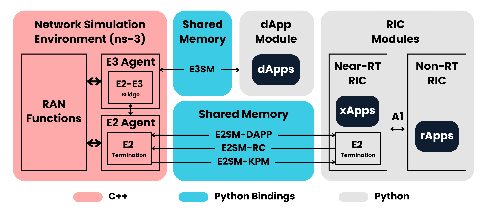

# ib-ORAN: Intent-Based Open RAN

[](https://spdx.org/licenses/MIT.html)
[](https://www.nsnam.org)
[](https://www.3gpp.org/)

ib-ORAN (`ns3-iboran`) is an [ns-3](https://www.nsnam.org) module for testing intent-based orchestration in Open RAN. You write the control logic in Python as Open RAN apps, and ib-ORAN runs it against a simulated LTE or 5G NR network. Alongside standard KPIs, it reports how well the expressed intent on each link is satisfied.

The apps follow the three Open RAN control loops. At the O-DU, dApps act in real time below 10 ms, and in the Near-RT RIC, xApps act between 10 ms and 1 s. rApps in the Non-RT RIC, which act above 1 s, are planned.

LTE is simulated with an adapted version of the ns-3 `lte` module, and 5G NR with the [5G-LENA](https://gitlab.com/cttc-lena/nr) `nr` module.

## Architecture

<div align="center">
  
</div>

ib-ORAN separates the network simulation from the control logic. On one side, the network simulator, written in C++ on top of ns-3, contains the RAN functions and the E2 and E3 agents that expose them. On the other side, the dApps, the Near-RT RIC with its xApps, and the Non-RT RIC with its rApps run in Python and reach those agents through the shared-memory interface of [ns3-ai](https://github.com/hust-diangroup/ns3-ai).

The Near-RT RIC uses the E2 service models E2SM-KPM, E2SM-RC and E2SM-DAPP, the dApps use the E3 service model (E3SM), and the two RICs communicate over A1. The E2-E3 bridge relays E2SM-DAPP messages between the Near-RT RIC and the dApps. The fields of each message are listed in [service models](doc/service-models.md).

> [!NOTE]
> E3 and E2SM-DAPP are not yet standardized. The other interfaces and service models follow the O-RAN Alliance specifications.

## Installation

ib-ORAN builds as an ns-3 contrib module. It is tested with [ns-3.48](https://gitlab.com/nsnam/ns-3-dev), [ns3-ai](https://github.com/hust-diangroup/ns3-ai) from its `main` branch, [5G-LENA nr](https://gitlab.com/cttc-lena/nr) 5.1 and Python 3.11. The full list of prerequisites and the step-by-step procedure are in [installation](doc/installation.md).

Clone ns-3 and the three contrib modules:

```shell
git clone --branch ns-3.48 --depth 1 https://gitlab.com/nsnam/ns-3-dev.git ns-3
cd ns-3
git clone https://github.com/hust-diangroup/ns3-ai.git contrib/ai
rm -rf contrib/ai/examples
git clone --branch v5.1 --depth 1 https://gitlab.com/cttc-lena/nr.git contrib/nr
git clone https://github.com/Orange-OpenSource/ns3-iboran.git contrib/iboran
```

> [!NOTE]
> The versions above are the tested ones. Newer releases are expected to work, but each nr release supports one ns-3 release, so pick a pair from the [nr release timeline](https://5g-lena.cttc.es/features/roadmap/).

Create a Python virtual environment in the ns-3 root and install the ns3-ai Python interfaces:

```shell
python3 -m venv .venv
source .venv/bin/activate
pip install -e contrib/ai/python_utils
pip install -e contrib/ai/model/gym-interface/py
```

Configure and build ns-3 with all contrib modules:

```shell
./ns3 configure --enable-examples --enable-tests
./ns3 build
```

Run the setup script, which installs the Python dependencies of ib-ORAN into the virtual environment, rebuilds the module and verifies the installation:

```shell
cd contrib/iboran
bash quick-setup.sh
```

## Usage

The parameters, campaigns, and reproducibility are described in [usage](doc/usage.md).

### Single run

A single simulation runs from `model/iboran_campaign`:

```shell
cd contrib/iboran/model/iboran_campaign
python3 iboran_run.py --rat_type="NR" --k=3 --dapp_algo_ue_selection="ibTopKCqi"
```

Parameters omitted on the command line take their values from [`iboranConfig.yaml`](model/iboran_campaign/iboranConfig.yaml). The full parameter list is in [usage](doc/usage.md#parameters).

### Campaign

For larger evaluations, [`iboran_campaign.py`](model/iboran_campaign/iboran_campaign.py) sweeps parameters and control algorithms over Monte Carlo replications. The notebook [`iboran_evaluation.ipynb`](notebook/iboran_evaluation.ipynb) sets up a campaign and compares scheduling algorithms.

Each run writes its [KPIs](doc/kpis.md), logs and a NetAnim animation file to `notebook/`. See [simulation data](doc/simulation-data.md) and [visualization](doc/visualization.md).

## Documentation

| Document | Content |
|---|---|
| [Installation](doc/installation.md) | Prerequisites, installation steps and troubleshooting |
| [Usage](doc/usage.md) | Run parameters, examples, campaigns, and reproducibility |
| [Apps](doc/apps.md) | Implemented dApps, xApps and rApps |
| [Algorithms](doc/algorithms.md) | dApp UE selection and xApp RBG bounding algorithms |
| [Service models](doc/service-models.md) | Message fields of each E2 and E3 service model |
| [Simulation data](doc/simulation-data.md) | Payload formats, datasets, embedding models and run outputs |
| [KPIs](doc/kpis.md) | Standard, intent-based and control KPIs |
| [Visualization](doc/visualization.md) | Viewing runs in NetAnim |
| [Changelog](CHANGELOG.md) | Changes in each release |

## Contributing

Ask questions in [Discussions](https://github.com/Orange-OpenSource/ns3-iboran/discussions) and report bugs in [Issues](https://github.com/Orange-OpenSource/ns3-iboran/issues). Check existing issues before opening a new one. A bug report should state the ib-ORAN commit or release, the ns-3, ns3-ai, nr and Python versions, the OS and compiler, the command that failed and its full error output.

Pull requests are welcome. Read [CONTRIBUTING.md](CONTRIBUTING.md) before opening one. Everyone taking part in the project follows the [code of conduct](.github/CODE_OF_CONDUCT.md). A new dApp, xApp, rApp or algorithm must also be listed in [apps](doc/apps.md) or [algorithms](doc/algorithms.md).

## Citation

If you use ib-ORAN in your research, cite the following paper:

```bibtex
@inproceedings{agheli2026iboran,
  author        = {Agheli, Pouya and Lefebvre, Gr{\'e}goire},
  title         = {Intent-Based Orchestration in Open RAN: An ns-3 Simulation Framework},
  booktitle     = {European Conference on Networks and Communications (EuCNC)},
  year          = {2026},
  url           = {https://ieeexplore.ieee.org/document/11577276},
  eprint        = {2605.30079},
  archivePrefix = {arXiv}
}
```

To cite the software itself:

```bibtex
@software{iboran,
  author  = {Agheli, Pouya and Lefebvre, Gr{\'e}goire},
  title   = {ib-ORAN: Intent-Based Open RAN},
  year    = {2026},
  url     = {https://github.com/Orange-OpenSource/ns3-iboran},
  license = {MIT}
}
```

## Acknowledgement

ib-ORAN is developed within the ANR COMSEMA project, funded by the French National Research Agency (ANR).

## License

The original contributions in this repository are licensed under the [MIT License](LICENSE). Third-party components keep their own copyright notices and licenses, which are preserved in their directories and summarized in [THIRD-PARTY.txt](THIRD-PARTY.txt).
