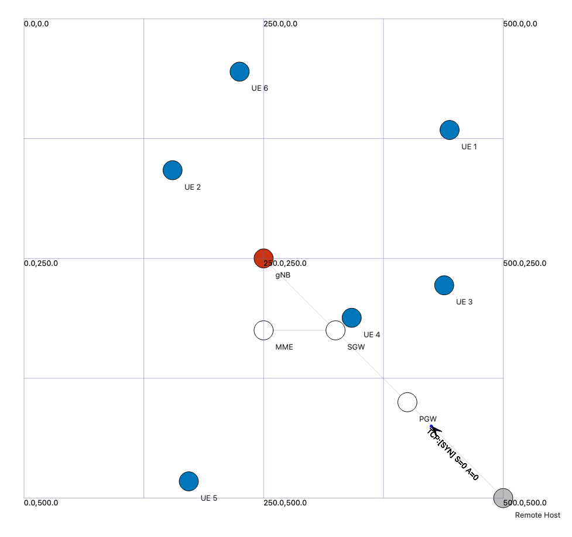

# Visualization

This document describes how to view ib-ORAN runs. Paths are relative to the ns-3 root.

## NetAnim

Each run writes an XML animation file for [NetAnim](https://www.nsnam.org/wiki/NetAnim), which shows node positions, mobility and packet transmissions. The file is `iboran-lte-anim.xml` or `iboran-nr-anim.xml`, depending on the RAT, and is written to `contrib/iboran/notebook/netanim/`.

<div align="center">
  
</div>

NetAnim view of an NR run with the default configuration: six UEs in a 500 m × 500 m area, with one gNB at its center. The UEs start at random positions, set by `--rng_run`, and move by random walk. LTE and NR runs both use the EPC as core network, with the MME, SGW and PGW linked to the remote host. An LTE run shows an eNodeB in place of the gNB.

> [!NOTE]
> Each run overwrites the animation file of its RAT.

### Building NetAnim

> [!IMPORTANT]
> NetAnim requires Qt. The NetAnim wiki page lists the supported versions.

Clone and build NetAnim in the ns-3 root:

```shell
git clone https://gitlab.com/nsnam/netanim.git
cd netanim
mkdir build && cd build
cmake .. && cmake --build .
```

### Opening an animation

Start NetAnim from `netanim/build`:

```shell
./netanim
```

Then open `iboran-lte-anim.xml` or `iboran-nr-anim.xml` from `contrib/iboran/notebook/netanim/`.
